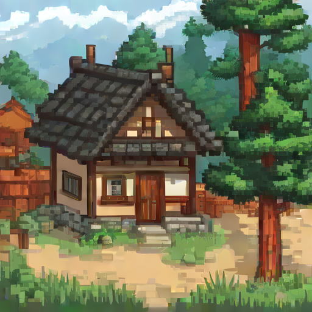

# SDXL LoRA 소규모 실행 확인 · 2026-11-24

Furiosa RNGD, Furiosa Torch/TCC 2026.4.0, PyTorch 2.10.0+cpu, Python 3.11, Diffusers 0.41.0에서 기존 SDXL EDF를 재사용했습니다. 전체 모델 재컴파일은 하지 않았습니다. 기준 패키지는 SDXL Turbo 512×512·1스텝 프로필이며 UNet LoRA 가져오기 어댑터를 추가한 재패키징본입니다. 텍스트 인코더·UNet·VAE는 저장된 NPU 실행계획을 사용하고 토큰화·스케줄러·PNG 변환은 호스트가 수행합니다.

각 후보의 고정 리비전과 원본 파일은 공통 카탈로그에 기록했습니다. 공식 Diffusers 변환 후 722개 UNet A/B 쌍 전체의 이름·형상·dtype을 확인하고 원래 파라미터 계약에 결합했습니다. 추가 컴파일 없이 가중치만 갱신했습니다. 시드42에서 LoRA 미적용·강도0.7 적용 출력을 비교해 PNG SHA256이 달라지는 것을 확인했습니다. 세 이미지의 스타일을 육안 확인했으며 독립적인 품질 벤치마크는 아닙니다.

| LoRA | 적용 효과 | 적용 이미지 |
|---|---|---|
| 3D Render Style XL | 입체 로봇·제품 렌더풍 |  |
| Papercut SDXL | 종이공예풍 건축·배경 |  |
| Pixel Art XL | 픽셀아트 건축·배경 |  |

이 결과는 한국어 프롬프트 이해 향상을 입증하지 않습니다. 적용 전후 최초 가중치 전송·LoRA 변경을 포함한 요청 시간은 약7–9초였고, 순수 추론 FPS 비교를 위한 측정이 아닙니다. 원본 LoRA 가중치는 재배포하지 않습니다. OpenRAIL-M 및 Apache-2.0 등 개별 원본의 이용조건도 확인하세요.

잘못된 긴 프롬프트는 CPU 사전검사에서 거부하고 같은 모델 프로세스로 다음 정상 요청이 성공하는 것도 확인했습니다.
